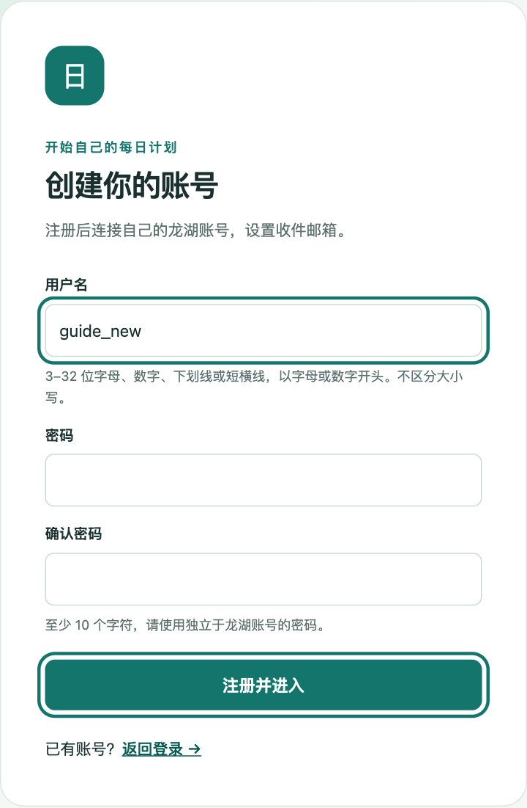
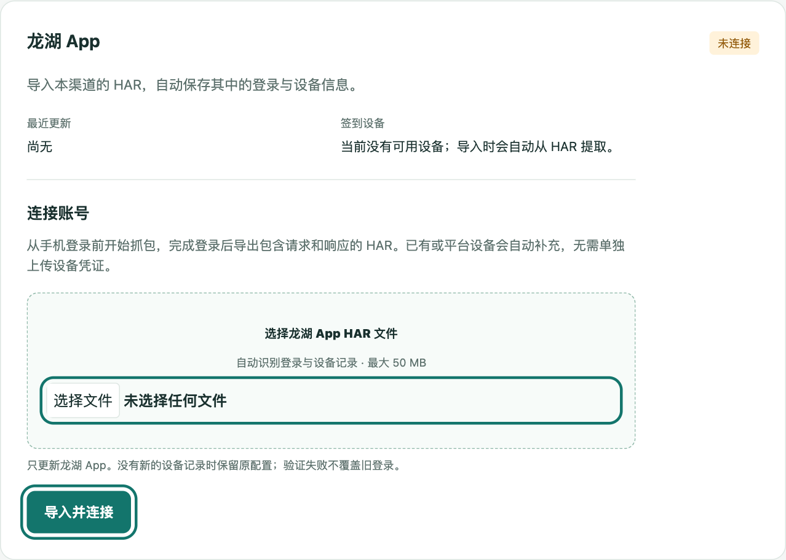
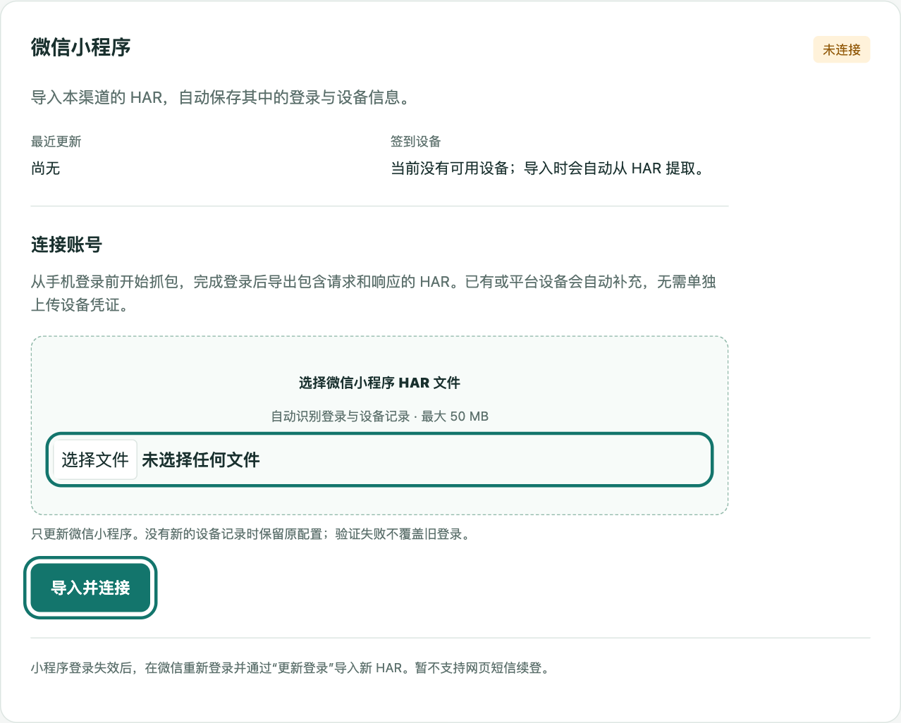
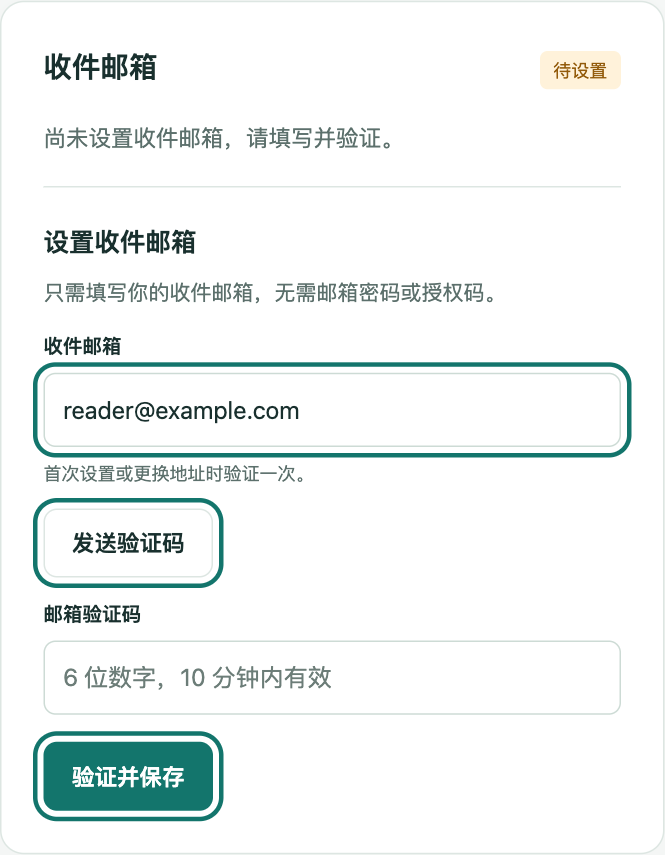
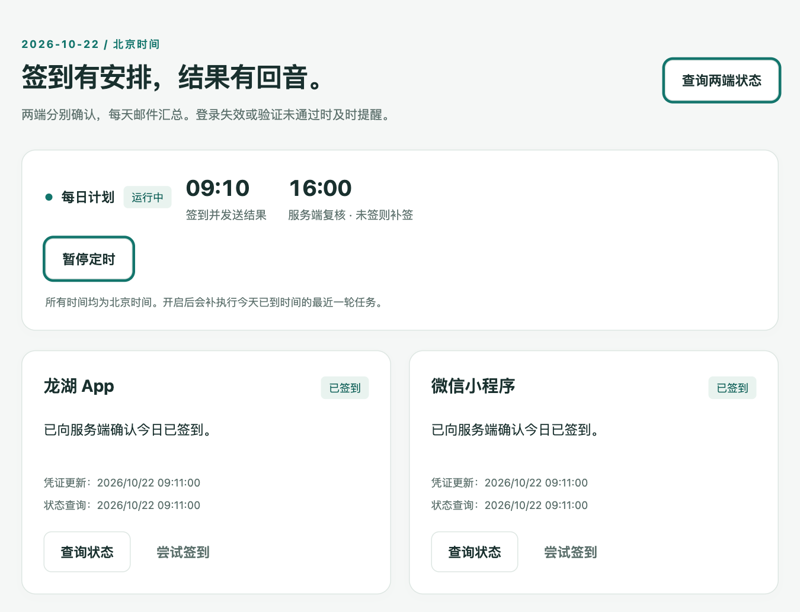
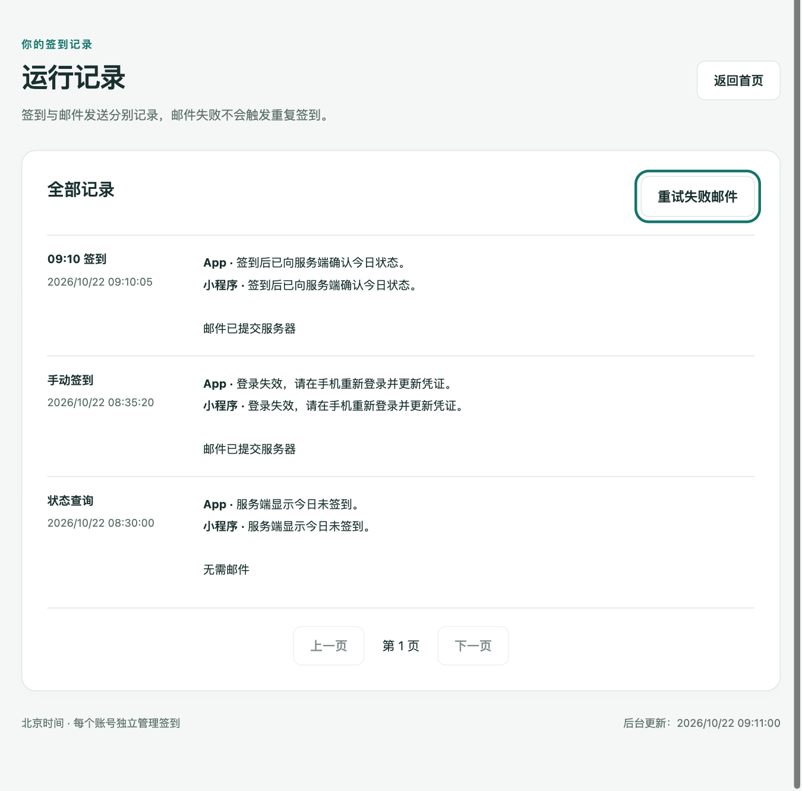
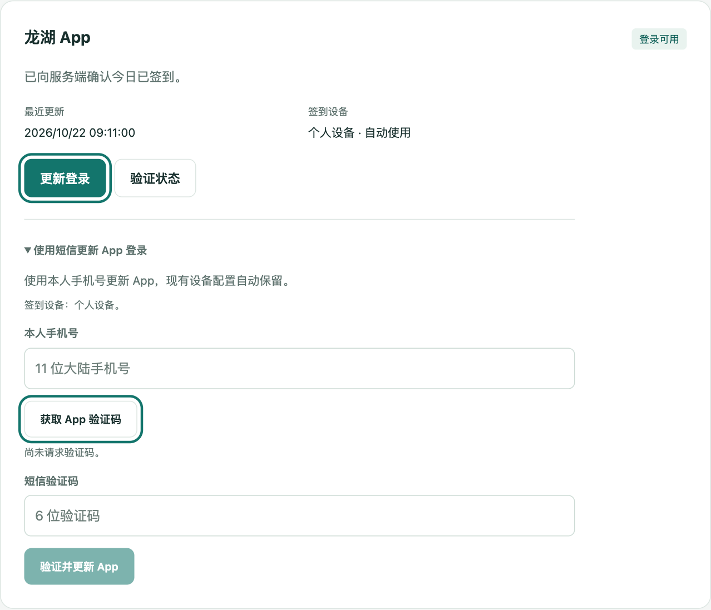

# 每日签到用户操作手册

适用版本：2026 年 10 月 22 日。

注册本站账号 → 分别导入 App／小程序 HAR → 验证邮箱 → 开启每日计划。

截图使用示例账号与模拟状态，绿色框标出主要操作。所有时间均为北京时间。

## 开始前：先认识两种账号

**本站账号**用于登录这个平台；**龙湖账号**用于 App／小程序签到。两者分开，注册本站账号不会自动登录龙湖。

### 首次设置按这个顺序完成

1. 注册并登录本站账号。
2. 分别准备 App、小程序的 HAR 文件，各导入一次。
3. 填写收件邮箱，输入邮箱验证码完成验证。
4. 确认两端登录可用、签到设备齐全，再回首页开启定时。

你需要：自己的龙湖账号、能正常登录的手机 App／微信小程序、一个能接收邮件的邮箱，以及包含成功登录响应的 HAR 文件。

已有配置的用户不用重做首次设置。到对应页面点击“更新登录”或“修改”，只调整需要变更的部分。

## 01 注册并登录本站

1. 打开平台登录页，点击**“注册自己的账号”**。
2. 设置用户名：3–32 位字母、数字、下划线或短横线，以字母或数字开头，不区分大小写。
3. 设置并确认密码：10–128 个字符，使用独立于龙湖账号的密码。
4. 点击**“注册并进入”**。以后用这组用户名和密码登录平台。

如果看不到注册入口，说明平台暂未开放注册，请联系管理员。忘记普通用户密码时也请联系管理员重置。

*图 1 · 创建的是本站账号，不是龙湖账号。*

## 02 准备 App 和小程序 HAR

每个渠道一份 HAR，里面可以同时包含登录和设备记录，**不用再单独上传设备凭证文件**。文件必须保留请求和响应；只截屏、复制文件名，或者只抓到加密隧道记录都不能代替 HAR。

1. **先开始记录**：选择要导出的 App 或小程序
2. **完成本人登录**：保留登录成功的请求与响应
3. **导出 HAR**：存到手机“文件”或电脑本地

1. 在你使用的抓包工具里开启记录，确认能看到 HTTPS 请求和响应内容。具体证书与工具设置以工具说明为准。
2. 在**龙湖 App** 中完成一次自己的登录，等到登录成功后的页面正常显示。如果设备信息也需要补齐，在这次记录中继续包含一次正常签到请求。
3. 停止记录并导出 HAR，建议命名为 `app-login.har`。
4. 切换到**微信小程序**，重新开始一段记录，完成小程序内的本人登录，再导出 `mini-login.har`。

抓多久取决于是否抓全步骤。已经登录后只刷新首页，可能没有成功登录响应；应从本次登录前开始记录。无需为了“抓得久一点”反复点签到。

### 只抓登录可以吗？

个人或平台已经有可用签到设备时，仅含成功登录响应的包即可更新登录。两边都没有签到设备时，需要在**同一份 HAR** 内补齐正常签到请求。登录用的设备标识不能直接代替签到设备。

HAR 可能含账号登录凭证。只在自己的账号页面导入，不要发到群聊、公开网盘或公共仓库。

## 03 分别连接 App 和微信小程序

1. 打开顶部的**“龙湖账号”**，先选**“龙湖 App”**。
2. 选择 App HAR，点击**“导入并连接”**。已配置过的账号先点“更新登录”，再点“保存更新”。
3. 等待查询验证结果。新登录验证失败时，原配置会保留。
4. 切换到**“微信小程序”**，选择小程序 HAR，按同样步骤导入。

每次只更新当前选中的渠道。即使文件同时包含两端记录，也要分别在两端入口导入。小程序 HAR 不能放到 App 入口替代 App 登录。

*图 2 · App 入口：登录与设备信息自动识别、合并。*

*图 3 · 小程序入口：选择小程序自己的 HAR。*

### 导入后检查这两项

- **登录状态：**“登录可用”表示已通过状态查询；“未签到”也可能是正常的有效登录状态。
- **签到设备：**显示个人设备或平台设备即可；显示缺少设备时，按提示补齐同一份 HAR 后更新。

导入只验证状态，不会立即执行签到。“已保存”或“已导入”也不等于今日已签到；是否成功要看首页的当天状态。

## 04 设置自己的收件邮箱

1. 进入**“通知与账号”**，填写自己的收件地址。
2. 点击**“发送验证码”**，去该邮箱查收。
3. 输入本次 6 位验证码，10 分钟内点击**“验证并保存”**。
4. 看到“已验证”后，点击**“发送测试通知”**确认能收到邮件。

*图 4 · 普通用户只填收件邮箱，不填邮箱密码或授权码。*

收件地址不限 QQ、163。平台发件服务由管理员统一配置，目前支持 QQ／163；如果页面提示“平台发信尚未配置”，请先联系管理员。

更换地址时点击“修改收件邮箱”。**新地址验证成功前，通知仍发到旧地址**；取消修改不会清除原设置。未收到验证码时，先检查地址、垃圾邮件和收件延迟，不要连续重复发送。

## 05 开启每日计划

首次默认暂停。确认两个渠道已连接、收件邮箱已验证且平台可以发信后，回首页点击**“开启定时”**，状态变为**“运行中”**。

| 北京时间 | 任务 | 说明 |
|---|---|---|
| 09:10 | 签到并发送结果 | 分别检查 App 和小程序。 |
| 16:00 | 复核，未签则补签 | 向服务端确认当天状态。 |

*图 5 · 每日计划和两端状态都在首页查看。*

所有时间均为**北京时间**。如果开启时已过当天计划时间，系统会补执行今天最近一轮；不会补历史日期。每个用户单独控制开关。

开启后可以关闭网页，任务由平台后台运行；平台服务器需要正常在线。想停止自动执行时，回首页点击“暂停定时”。

“查询两端状态”只查结果；渠道卡片上的“尝试签到”会执行签到流程。手动操作前先查询，避免仅凭页面旧记录判断失败。

## 06 看懂签到与邮件结果

首页显示最近 5 条运行记录。点击**“查看更多 →”**或顶部**“运行记录”**，查看全部记录并翻页。

*图 6 · 签到结果与邮件发送结果分开显示。*

**已签到**：已向服务端确认当天已签到。

**未签到**：服务端显示今天尚未签到，当前查询可能只是检查操作。

**登录失效**：在对应手机端重新登录，再到“龙湖账号”更新该渠道。

**待确认 / 请求异常**：暂时不能确认成功。先查询状态，保留错误提示，不要连续重复提交。

**需要验证**：当前验证未通过时，回手机端处理或完成签到，再回平台查询。

### 邮件状态单独看

“邮件已提交服务器”表示发件服务器已接受，不保证立刻进入收件箱；“邮件待发送 / 重试中”表示后台会继续尝试；“邮件发送失败”可在记录页点击“重试失败邮件”。

邮件失败不会重新执行签到。“状态查询”记录显示“无需邮件”是正常情况。任务结果按两端分别列出，App 成功不能代表小程序也成功。

## 07 以后怎么更新登录和设置

### 更新 App 登录

到“龙湖账号 → 龙湖 App”，点击“更新登录”，导入新 HAR 并保存。已经导入本人 App 登录、设备条件满足时，也可展开**“使用短信更新 App 登录”**，输入本人手机号，主动获取新验证码，再点“验证并更新 App”。验证码需在有效期内使用，短信方式是否可用取决于服务端校验。

*图 7 · 已配置后直接更新；App 短信只更新 App。*

### 更新小程序登录

在微信小程序重新完成本人登录，导出新 HAR，到“龙湖账号 → 微信小程序 → 更新登录”保存。**目前不支持网页短信更新小程序**，不要用 App 验证码代替。

### 修改邮箱与本站密码

邮箱：进入“通知与账号 → 修改收件邮箱”，验证新地址后保存。密码：在同一页展开“修改登录密码”，填写当前密码与新密码；保存后重新登录本站，龙湖登录配置不受影响。

更新时，未包含新的设备记录会沿用原配置或平台设备。验证失败保留旧配置；点击“取消修改”放弃当前输入。正在填写的内容不会被后台刷新自动覆盖。

## 常见问题与求助

### 手机选文件时 HAR 是灰色，怎么办？

关闭当前文件选择窗口，刷新平台页面后重新打开。当前版本已取消上传类型筛选，不需要改后缀。若文件在云盘尚未下载，先在手机“文件”中下载到本地，再选取原始 HAR。

### 提示“未找到请求”，应该重抓多久？

关键是步骤完整，不是时长。确认导出的是 HAR 而非压缩包、截图或加密隧道记录，包含成功登录的请求与响应，并选对 App／小程序入口。从本次登录前开始记录，登录成功后导出。

### 提示“状态查询未通过”，是文件没有导进去吗？

可能已经解析到登录信息，但服务端查询没有通过。新原生登录未通过验证时不会覆盖旧配置。先检查账号是否刚刚成功登录，按页面给出的登录失效、网络或业务错误处理；网络错误不一定需要重新抓包。

### 提示“缺少签到设备”，不是已经导入登录了吗？

登录信息与签到设备不同。平台先用你的个人设备，缺少时再用管理员共享设备。都没有时，在对应渠道的同一份 HAR 内包含正常签到请求后更新，不需要另传一份设备文件。

### App 成功，小程序失败，要把两端都重配吗？

不用。两端独立处理，只更新或排查失败的渠道。先看运行记录中的具体渠道与错误，不能只看整轮任务或邮件是否发送。

### 今天忘记开启，系统会补以前的签到吗？

只会补执行今天已到时间的最近一轮，不补历史日期。能否签到仍以活动开放状态及服务端结果为准。

### 邮件没收到，要再点一次签到吗？

先看签到状态和邮件状态。签到已成功时无需为了邮件重新签到；检查垃圾邮件、等待投递，必要时用“重试失败邮件”或联系管理员。

### 忘记本站密码，或者无法注册怎么办？

联系管理员重置本站密码或确认注册是否开放。本站密码与龙湖密码分开，不需要把龙湖密码或验证码发给管理员。

### 仍然无法解决时，提供这 4 项就够了

本站用户名、失败渠道、发生时间、完整错误提示或运行记录截图。注意遮住手机号和邮箱；不要发送登录 Token、短信验证码、完整 HAR 或邮箱授权码。

适用版本：2026 年 10 月 22 日的页面与功能。活动、登录或服务端校验变化时，以平台实际提示为准。

